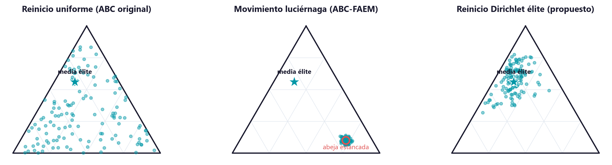

# Anexo A. Diagnóstico y rediseño del mecanismo explorador en el algoritmo ABC

> Este anexo presenta un análisis diagnóstico complementario sobre la activación del
> mecanismo explorador (*scout*) y una línea de extensión basada en un reinicio de
> Dirichlet. Las cifras de activación y desempeño se obtienen mediante ejecuciones
> reproducibles sobre los datos y las convenciones metodológicas de la tesis. Los
> resultados, parámetros y conclusiones del cuerpo principal permanecen inalterados.

## A.1. Motivación y alcance de la mejora incremental

El punto de partida de esta investigación es el desempeño del algoritmo ABC original,
que supera consistentemente a los referentes clásicos —la optimización media-varianza
(PMVG) y la asignación equiponderada (1/N)— en el ratio de Sortino para todos los
regímenes de volatilidad analizados. Este resultado sustenta la hipótesis central de la
tesis y se conserva sin modificaciones.

Sobre esa base, el trabajo persigue una mejora incremental. El ABC tiene limitaciones
conocidas en su capacidad de explotación local; para atacarlas se evaluó primero el
ABC-FA de Tuba y Bacanin (2014), que inserta un movimiento tipo luciérnaga en la fase de
abejas empleadas. En los escenarios de este estudio, sin embargo, esa variante no ofrece
un buen desempeño (su mecanismo sí se ejecuta, y aun así queda por debajo del ABC
original). Ante ese resultado, la tesis propone alterar específicamente la **fase
exploradora** (*scout*) del ABC —mediante un disparador probabilístico (PFA), una
atracción guiada por élites (ABC-FAEM) y una atracción gravitacional (ABC-GSA)— con el
objetivo de superar las limitaciones del original. Estas variantes se entienden como
propuestas de mejora sujetas a verificación empírica.

El diagnóstico que motiva este anexo muestra que, dada la dimensionalidad del problema,
los mecanismos asociados a la fase exploradora no llegan a ejecutarse bajo la
configuración calibrada. A partir de este hallazgo se plantean dos preguntas: (i) ¿cómo
lograr que el explorador se active? y (ii) ¿qué efecto produce su activación sobre el
desempeño?

## A.2. Inactividad del explorador bajo la calibración

El umbral de abandono se deriva de forma proporcional a la dimensión, `max_trials = 0.6 ×
25 abejas × 20 activos = 300`. Pero el contador de intentos de una abeja solo crece cuando
un movimiento no mejora su fuente, y dentro del presupuesto de 60 iteraciones dicho
contador alcanza un máximo observado cercano a **19**. Ninguna abeja supera el umbral de
300 y la fase exploradora **no se ejecuta en ninguna de las configuraciones evaluadas**
(ambos universos, cuatro regímenes y 20 semillas). Dado que las variantes redefinen
exclusivamente el movimiento del explorador, las diferencias observadas entre el ABC
original, el ABC-FAEM y el ABC-GSA bajo esta calibración provienen de sus trayectorias
estocásticas, no de la intervención efectiva de dicho mecanismo.

## A.3. Instrumentación: telemetría de activación

Para pasar de la inferencia indirecta a la medición directa, se instrumentó cada ejecución
con el número de activaciones del explorador y las iteraciones en que ocurren. El Cuadro
A.1 reporta las activaciones medias por ejecución (ambos universos) para la configuración
calibrada y para umbrales de activación proporcionales al presupuesto de iteraciones.

**Cuadro A.1. Activaciones medias del explorador por ejecución.**

| Configuración | COVID-19 | Crisis 2007–09 | Guerra | Estabilidad |
| --- | ---: | ---: | ---: | ---: |
| ABC original (calibrado) | 0.0 | 0.0 | 0.0 | 0.0 |
| ABC-GSA con umbral canónico (`max_trials`=300) | 0.0 | 0.0 | 0.0 | 0.0 |
| ABC-GSA activo (`max_trials`=9) | 10.9 | 9.9 | 9.8 | 10.4 |
| ABC-FAEM activo (`max_trials`=9) | 12.4 | 11.7 | 11.3 | 11.9 |
| Reinicio de Dirichlet élite (fracción 0.15) | 12.3 | 13.1 | 10.9 | 12.3 |

Bajo la calibración, el mecanismo permanece inactivo. Un umbral proporcional al horizonte
lo vuelve operativo a una tasa controlada (~10-13 activaciones por ejecución, cerca del
0,4% de las ~3.100 evaluaciones de la función objetivo).

## A.4. Desempeño de los mecanismos bajo activación

La evaluación del efecto de la activación exige emplear semillas idénticas entre
configuraciones, de modo que las comparaciones estadísticas sean efectivamente pareadas.
El Cuadro A.2 presenta el Sortino medio por semilla, agregado sobre las ocho celdas
régimen–universo.

**Cuadro A.2. Sortino medio por semilla (agregado, 8 celdas).**

| Configuración | Sortino medio |
| --- | ---: |
| Reinicio de Dirichlet élite f=0.15 *(extensión; sección A.6)* | **2.870** |
| ABC original | 2.145 |
| ABC-GSA con umbral canónico (inactivo) | 1.975 |
| ABC-FAEM activo mt=9 | 1.964 |
| ABC-GSA activo mt=9 | 1.860 |
| PMVG (media-varianza) | 1.161 |
| 1/N (equiponderado) | 0.920 |

Los resultados permiten establecer tres conclusiones:

- **Mejora marginal.** Al activar la atracción por luciérnagas (ABC-FAEM mt=9), el
  desempeño apenas se distingue del ABC original y presenta variaciones inconsistentes
  entre regímenes, como ya anticipaba el diagnóstico proporcional previo
  ([`faem_activation_calibration.md`](faem_activation_calibration.md)).
- **Deterioro bajo atracción gravitacional.** Al activar la atracción gravitacional
  (ABC-GSA mt=9), el desempeño queda por debajo del ABC original en las ocho celdas y la
  diferencia conserva significancia tras la corrección de Holm en seis de ellas,
  incluidas las de baja volatilidad (estabilidad). Este comportamiento, presente en
  distintos regímenes y universos, se analiza en la sección A.5.
- **Preservación de la hipótesis central.** El menor desempeño se produce frente al ABC
  original, no frente a los referentes clásicos. Incluso el caso menos favorable
  (ABC-GSA activo, 1.860) permanece por encima de PMVG (1.161) y de 1/N (0.920). Por
  tanto, la activación redistribuye el desempeño dentro de la familia bioinspirada sin
  transferir la ventaja a los métodos clásicos.

**Cuadro A.3. ABC-GSA activo frente a ABC original, por celda (Δ = GSA activo − ABC original).**

| Régimen | Δ universo fijo | Δ universo dinámico |
| --- | ---: | ---: |
| COVID-19 (crisis) | −0.537 (significativo tras Holm) | −0.462 (significativo tras Holm) |
| Crisis financiera global de 2008 | −0.055 (significativo) | −0.042 (no significativo) |
| Guerra 2022 (volatilidad alta) | −0.341 (significativo tras Holm) | −0.254 (significativo tras Holm) |
| Estabilidad 2023–24 (volatilidad baja) | −0.236 (significativo tras Holm) | −0.352 (significativo tras Holm) |

## A.5. El problema de fondo: el sesgo de normalización y la geometría

Los dos hallazgos de la sección A.4 —la activación por sí sola no garantiza una mejora y
los movimientos definidos en el espacio de caja pueden deteriorar el desempeño— apuntan
a una causa común de naturaleza geométrica.

El conjunto de portafolios factibles de solo posiciones largas (*long-only*) —vectores de
pesos no negativos que suman uno— constituye el **símplex de probabilidad**: un objeto
cuyos vértices representan la concentración total en un único activo, cuyo baricentro
corresponde a la asignación equiponderada (1/N) y cuyas aristas y caras corresponden a
portafolios que emplean solo un subconjunto de los activos (Figura A.1). Los movimientos
de recuperación que operan en el **espacio de caja** —el reinicio aleatorio uniforme, el
desplazamiento tipo luciérnaga o
la atracción gravitacional del ABC-GSA— generan candidatos que en general no pertenecen a
este conjunto y exigen una **renormalización posterior** (dividir por la suma de pesos).
Esta operación introduce un sesgo al distorsionar la perturbación pretendida. Además, el
ABC-GSA dirige el movimiento hacia el centro de masa del enjambre —una solución de
consenso que no necesariamente pertenece a la región de mejor desempeño— en lugar de
orientarlo hacia las soluciones élite. La combinación de ambos efectos explica el
deterioro observado tras su activación.

La pregunta natural es entonces: ¿cómo superar el sesgo de normalización? La respuesta que
propone la extensión es recomponer la solución **directamente sobre el símplex**, sin pasar
por el espacio de caja.

## A.6. Línea de extensión: reinicio de Dirichlet nativo del símplex

> Esta sección presenta una **extensión metodológica** y no modifica los resultados del
> cuerpo principal de la tesis.

Se propone un operador de reinicio que, cuando una abeja se estanca, la recompone mediante
una muestra de una **distribución de Dirichlet concentrada alrededor de la dirección
media de las soluciones élite**. La distribución de Dirichlet reside sobre el símplex por
construcción, de modo que todo candidato es un portafolio factible **sin necesidad de
reparación ni renormalización**; su vector de concentración regula el equilibrio entre
intensificación (permanecer cerca de la élite) y exploración (diversificar la composición).
Mientras que el reinicio en caja genera puntos que luego deben forzarse a ser válidos, el
muestreo de Dirichlet genera portafolios válidos desde el origen y los orienta hacia la
región donde la colonia ha identificado las mejores soluciones.

**Figura A.1.** Reubicación de una abeja estancada sobre el símplex de portafolios de tres
activos, según la política de recuperación. El reinicio uniforme (izquierda) dispersa los
candidatos por todo el símplex, ignorando la información de la colonia; el movimiento tipo
luciérnaga (centro) apenas desplaza la abeja de su posición estancada; el reinicio de
Dirichlet propuesto (derecha) concentra los candidatos alrededor de la dirección media
de las soluciones élite, generando portafolios factibles por construcción.

En la evaluación con semillas pareadas, el reinicio de Dirichlet (fracción 0.15) eleva el
Sortino medio por semilla de 2.145 (ABC original) a **2.870**, y obtiene además el mejor
valor medio de la función objetivo ejecutada, lo que indica que encuentra mejores
soluciones para el objetivo optimizado y no simplemente valores más favorables de la
métrica de evaluación. Las pruebas de Wilcoxon frente al ABC original, corregidas con el
procedimiento de Holm (1979)
dentro de cada celda, resultan significativas y favorables a Dirichlet élite en **las ocho
celdas** régimen–universo; ninguna otra configuración examinada presenta superioridad en
una celda después de la corrección.

Como control adicional frente a la selección, el ratio de Sharpe deflactado (DSR; Bailey
y López de Prado, 2014) del mejor portafolio del operador supera 0,95 en cuatro de las
ocho celdas —COVID-19 y estabilidad, en ambos universos, con valores de hasta 0,9998—,
pero se sitúa entre 0,51 y 0,72 durante la crisis financiera global y la guerra. En
consecuencia, la superioridad *relativa* del operador frente al ABC original conserva
significancia tras el control por comparaciones múltiples en todas las celdas, mientras
que la evidencia *absoluta* de desempeño distinguible del azar se establece
específicamente en las celdas de COVID-19 y estabilidad.

**Cuadro A.4. Sharpe deflactado del mejor portafolio de Dirichlet élite.**

| Régimen | Universo fijo | Universo dinámico |
| --- | ---: | ---: |
| COVID-19 (2020) | **0.9832** | **0.9801** |
| Crisis financiera global (2007–09) | 0.6467 | 0.5095 |
| Guerra (2022) | 0.6804 | 0.7208 |
| Estabilidad (2023–24) | **0.9998** | **0.9997** |

*Nota.* Los valores en negrita alcanzan el umbral de referencia DSR ≥ 0.95.

## A.7. Un procedimiento generalizable de diagnóstico y rediseño

El aporte de esta línea no es un movimiento de recuperación en particular, sino un
**procedimiento** aplicable a cualquier mecanismo explorador: registrar su activación
como una variable observable, emplear un umbral proporcional al horizonte, medir su
efecto mediante estadística pareada y, cuando la geometría del espacio de soluciones
condicione el valor de la recuperación, rediseñar el movimiento para respetarla. El
reinicio de Dirichlet constituye la aplicación de este procedimiento al problema
*long-only*. En este sentido, la extensión generaliza el trabajo de la tesis sin
reemplazar sus resultados principales.

## A.8. Relación con la literatura

El fenómeno de un operador explorador inactivo bajo la calibración empleada no es
exclusivo de este trabajo. Bullinaria y AlYahya (2014) observaron empíricamente que, con
la calibración predeterminada del ABC, la fase *scout* prácticamente no se activa y la
declararon redundante mediante ablación sobre el umbral de abandono. Singh y Deep (2019)
llegaron a una conclusión afín sobre el balance exploración-explotación del ABC, señalando
que el explorador puede volverse redundante en alta dimensión. Hussain et al. (2020),
mediante un análisis componente a componente basado en diversidad, reportan igualmente
que este componente puede aportar poco al desempeño. La contribución de este anexo
respecto de esa línea es doble: instrumentar la activación vinculada a una función
objetivo financiera y, a diferencia de los trabajos que se concentran en el diagnóstico,
vincular la auditoría con un rediseño que recupera valor.

El uso de la distribución de Dirichlet para representar pesos de portafolios *long-only*
sobre el símplex está establecido en la literatura financiera (André y Coqueret, 2020;
Yang, Park y Lee, 2022; Le Courtois y Xu, 2024), aunque en contextos de aprendizaje por
refuerzo o de construcción directa del conjunto eficiente, y no como operador dentro de una
metaheurística. La combinación específica —disparador por estancamiento, muestreo nativo
al símplex y condicionamiento a la media élite dentro del ABC— no aparece documentada en la
revisión realizada, lo que sugiere una línea de investigación abierta.

## A.9. Alcance, limitaciones y trabajo futuro

Los resultados de este anexo corresponden a un **diagnóstico exploratorio
complementario**. La interpretación debe considerar tres limitaciones: (i) la evaluación
se realiza dentro de muestra y sobre las mismas ventanas del estudio; (ii) las
configuraciones activadas emplean valores predeterminados sin una calibración específica;
y (iii) el Sharpe deflactado se calcula frente a las configuraciones examinadas, no frente
al espacio completo de diseño. Además, las cifras emplean el Sortino medio por semilla,
necesario para las pruebas pareadas, que difiere del criterio *best-of-seeds* reportado en
las tablas del cuerpo principal.

El paso confirmatorio natural es una validación *walk-forward* fuera de muestra sobre el
panel histórico completo, con calibración dedicada del parámetro de concentración y del
umbral de activación, incorporación de costos de transacción y universos de mayor tamaño.
Este programa excede el alcance del trabajo de grado y se plantea como línea futura. La
limitación identificada en el mecanismo explorador queda así documentada, medida y
explicada, y se traduce en un diseño reproducible que abre una vía concreta de mejora para
la familia de algoritmos propuesta.

## Referencias

André, E., y Coqueret, G. (2020). *Dirichlet policies for reinforced factor portfolios*
[preprint]. arXiv:2011.05381.

Bailey, D. H., y López de Prado, M. (2014). The deflated Sharpe ratio: Correcting for
selection bias, backtest overfitting, and non-normality. *The Journal of Portfolio
Management*, 40(5), 94–107.

Bullinaria, J. A., y AlYahya, K. (2014). Artificial Bee Colony training of neural
networks. En G. Terrazas, F. E. B. Otero y A. D. Masegosa (Eds.), *Nature Inspired
Cooperative Strategies for Optimization (NICSO 2013)* (Studies in Computational
Intelligence, Vol. 512, pp. 191–201). Springer.

Holm, S. (1979). A simple sequentially rejective multiple test procedure. *Scandinavian
Journal of Statistics*, 6(2), 65–70.

Hussain, K., Mohd Salleh, M. N., Cheng, S., Shi, Y., y Naseem, R. (2020). Artificial bee
colony algorithm: A component-wise analysis using diversity measurement. *Journal of
King Saud University – Computer and Information Sciences*, 32(7), 794–808.

Karaboga, D. (2005). *An idea based on honey bee swarm for numerical optimization*
(Technical Report TR-06). Erciyes University.

Le Courtois, O., y Xu, X. (2024). Efficient portfolios and extreme risks: A
Pareto–Dirichlet approach. *Annals of Operations Research*, 335(1), 261–292.

Singh, A., y Deep, K. (2019). Exploration–exploitation balance in Artificial Bee Colony
algorithm: A critical analysis. *Soft Computing*, 23, 9525–9536.

Tuba, M., y Bacanin, N. (2014). Artificial bee colony algorithm hybridized with firefly
algorithm for cardinality-constrained mean-variance portfolio selection. *Applied
Mathematics and Information Sciences*, 8(6), 2791–2801.

Yang, H., Park, H., y Lee, K. (2022). A selective portfolio management algorithm with
off-policy reinforcement learning using Dirichlet distribution. *Axioms*, 11(12), 664.

Yang, X.-S. (2009). Firefly algorithms for multimodal optimization. En *Stochastic
Algorithms: Foundations and Applications (SAGA 2009)* (Lecture Notes in Computer Science,
Vol. 5792, pp. 169–178). Springer.
