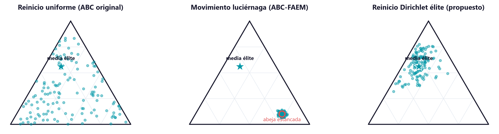

# Annex A. Diagnosis and redesign of the scout mechanism in the ABC algorithm

*English translation of [`anexo_activacion_scout.md`](anexo_activacion_scout.md); the
Spanish text is the original.*

> This annex presents a complementary diagnostic analysis of the activation of the scout
> mechanism and a line of extension based on a Dirichlet restart. The activation and
> performance figures come from reproducible runs on the thesis's data and methodological
> conventions. The results, parameters, and conclusions of the main body remain
> unchanged.
>
> This is an extended version of Annex A of the approved thesis. Sections A.1 to A.4
> develop the activation diagnostic included in the thesis; sections A.5 onward (sampling
> geometry, Dirichlet restart, and concentration limits) are exploratory work carried out
> after approval by Norbey Pidiache.

## A.1. Motivation and scope of the incremental improvement

The starting point of this research is the performance of the original ABC algorithm,
which consistently beats the classical benchmarks — mean-variance optimization (PMVG)
and equal weighting (1/N) — on the Sortino ratio in every volatility regime analyzed.
This result supports the central hypothesis of the thesis and is kept without
modification.

On that basis, the work pursues an incremental improvement. ABC has known limitations
in its local exploitation capacity; to address them, the ABC-FA of Tuba and Bacanin
(2014), which inserts a firefly-type move in the employed-bee phase, was evaluated
first. In the scenarios of this study, however, that variant does not perform well (its
mechanism does execute, and it still falls below the original ABC). Given that result,
the thesis proposes altering specifically the **scout phase** of ABC — through a
probabilistic trigger (PFA), an elite-guided attraction (ABC-FAEM), and a gravitational
attraction (ABC-GSA) — with the aim of overcoming the limitations of the original.
These variants are understood as improvement proposals subject to empirical
verification.

The diagnostic that motivates this annex shows that, given the dimensionality of the
problem, the mechanisms attached to the scout phase never execute under the calibrated
configuration. Two questions follow from this finding: (i) how can the scout be made to
activate? and (ii) what effect does its activation have on performance?

## A.2. Scout inactivity under the calibration

The abandonment threshold is derived proportionally to the dimension, `max_trials = 0.6
× 25 bees × 20 assets = 300`. But a bee's trial counter only grows when a move fails to
improve its source, and within the 60-iteration budget that counter reaches an observed
maximum of about **19**. No bee exceeds the threshold of 300, and the scout phase
**does not execute in any of the configurations evaluated** (both universes, four
regimes, and 20 seeds). Since the variants redefine only the scout's move, the
differences observed between the original ABC, ABC-FAEM, and ABC-GSA under this
calibration come from their stochastic trajectories, not from the effective
intervention of that mechanism.

## A.3. Instrumentation: activation telemetry

To move from indirect inference to direct measurement, every run was instrumented with
the number of scout activations and the iterations at which they occur. Table A.1
reports the mean activations per run (both universes) for the calibrated configuration
and for activation thresholds proportional to the iteration budget.

**Table A.1. Mean scout activations per run.**

| Configuration | COVID-19 | Crisis 2007–09 | War | Stability |
| --- | ---: | ---: | ---: | ---: |
| Original ABC (calibrated) | 0.0 | 0.0 | 0.0 | 0.0 |
| ABC-GSA with canonical threshold (`max_trials`=300) | 0.0 | 0.0 | 0.0 | 0.0 |
| Active ABC-GSA (`max_trials`=9) | 10.9 | 9.9 | 9.8 | 10.4 |
| Active ABC-FAEM (`max_trials`=9) | 12.4 | 11.7 | 11.3 | 11.9 |
| Elite Dirichlet restart (fraction 0.15) | 12.3 | 13.1 | 10.9 | 12.3 |

Under the calibration, the mechanism stays inactive. A threshold proportional to the
horizon makes it operational at a controlled rate (~10–13 activations per run, close to
0.4% of the ~3,100 objective-function evaluations).

## A.4. Performance of the mechanisms under activation

Assessing the effect of activation requires identical seeds across configurations, so
that the statistical comparisons are genuinely paired. Table A.2 presents the mean
per-seed Sortino, aggregated over the eight regime–universe cells.

**Table A.2. Mean per-seed Sortino (aggregate, 8 cells).**

| Configuration | Mean Sortino |
| --- | ---: |
| Elite Dirichlet restart f=0.15 *(post-thesis, without a concentration limit; see A.6–A.7)* | **2.870** |
| Original ABC | 2.145 |
| ABC-GSA with canonical threshold (inactive) | 1.975 |
| Active ABC-FAEM mt=9 | 1.964 |
| Active ABC-GSA mt=9 | 1.860 |
| PMVG (mean-variance) | 1.161 |
| 1/N (equal-weighted) | 0.920 |

The results support three conclusions:

- **Marginal improvement.** When the firefly attraction is activated (ABC-FAEM mt=9),
  performance is barely distinguishable from the original ABC and varies inconsistently
  across regimes, as the earlier proportional diagnostic already anticipated
  ([`faem_activation_calibration.md`](faem_activation_calibration.md)).
- **Deterioration under gravitational attraction.** When the gravitational attraction
  is activated (ABC-GSA mt=9), performance falls below the original ABC in all eight
  cells, and the difference remains significant after the Holm correction in six of
  them, including the low-volatility (stability) cells. This behavior, present across
  regimes and universes, is analyzed in section A.5.
- **The central hypothesis is preserved.** The lower performance is relative to the
  original ABC, not to the classical benchmarks. Even the least favorable case (active
  ABC-GSA, 1.860) remains above PMVG (1.161) and 1/N (0.920). Activation therefore
  redistributes performance within the bio-inspired family without transferring the
  advantage to the classical methods.

**Table A.3. Active ABC-GSA versus original ABC, by cell (Δ = active GSA − original ABC).**

| Regime | Δ fixed universe | Δ dynamic universe |
| --- | ---: | ---: |
| COVID-19 (crisis) | −0.537 (significant after Holm) | −0.462 (significant after Holm) |
| 2008 global financial crisis | −0.055 (significant) | −0.042 (not significant) |
| War 2022 (high volatility) | −0.341 (significant after Holm) | −0.254 (significant after Holm) |
| Stability 2023–24 (low volatility) | −0.236 (significant after Holm) | −0.352 (significant after Holm) |

## A.5. The underlying problem: normalization bias and geometry

The two findings of section A.4 — activation alone does not guarantee an improvement,
and moves defined in box space can degrade performance — point to a common cause of a
geometric nature.

The set of feasible long-only portfolios — vectors of non-negative weights that sum to
one — is the **probability simplex**: an object whose vertices represent total
concentration in a single asset, whose barycenter corresponds to the equal-weighted
allocation (1/N), and whose edges and faces correspond to portfolios that use only a
subset of the assets (Figure A.1). Recovery moves that operate in **box space** — the
uniform random restart, the firefly-type displacement, or the gravitational attraction
of ABC-GSA — generate candidates that generally do not belong to this set and require a
**subsequent renormalization** (dividing by the sum of the weights). This operation
introduces a bias by distorting the intended perturbation. In addition, ABC-GSA directs
the move toward the swarm's center of mass — a consensus solution that does not
necessarily belong to the best-performing region — rather than toward the elite
solutions. The combination of both effects explains the deterioration observed after
its activation.

The natural question is then: how can the normalization bias be overcome? The answer
proposed by the extension is to rebuild the solution **directly on the simplex**,
without passing through box space.

## A.6. Line of extension: simplex-native Dirichlet restart

> This section presents a **methodological extension** and does not modify the results
> of the main body of the thesis.

A restart operator is proposed that, when a bee stalls, rebuilds it from a sample of a
**Dirichlet distribution concentrated around the mean direction of the elite
solutions**. The Dirichlet distribution lives on the simplex by construction, so every
candidate is a feasible portfolio **with no need for repair or renormalization**; its
concentration vector governs the balance between intensification (staying close to the
elite) and exploration (diversifying the composition). Whereas the box restart
generates points that must then be forced to be valid, Dirichlet sampling generates
valid portfolios from the outset and steers them toward the region where the colony has
identified the best solutions.

**Figure A.1.** Relocation of a stalled bee on the three-asset portfolio simplex,
according to the recovery policy. The uniform restart (left) scatters candidates over
the whole simplex, ignoring the colony's information; the firefly-type move (center)
barely displaces the bee from its stalled position; the proposed Dirichlet restart
(right) concentrates candidates around the mean direction of the elite solutions,
generating portfolios that are feasible by construction.

In the paired-seed evaluation, the Dirichlet restart (fraction 0.15) raises the mean
per-seed Sortino from 2.145 (original ABC) to **2.870**, and also achieves the best
mean value of the executed objective function, which indicates that it finds better
solutions for the optimized objective and not merely more favorable values of the
evaluation metric. The Wilcoxon tests against the original ABC, corrected with the
Holm (1979) procedure within each cell, are significant and favorable to the elite
Dirichlet restart in **all eight** regime–universe cells; no other configuration
examined shows superiority in any cell after the correction.

As an additional control against selection, the deflated Sharpe ratio (DSR; Bailey and
López de Prado, 2014) of the operator's best portfolio exceeds 0.95 in four of the
eight cells — COVID-19 and stability, in both universes, with values of up to 0.9998 —
but lies between 0.51 and 0.72 during the global financial crisis and the war.
Consequently, the operator's *relative* superiority over the original ABC remains
significant after controlling for multiple comparisons in every cell, while the
*absolute* evidence of performance distinguishable from chance is established
specifically in the COVID-19 and stability cells.

**Table A.4. Deflated Sharpe of the elite Dirichlet restart's best portfolio (variant
without a concentration constraint).**

| Regime | Fixed universe | Dynamic universe |
| --- | ---: | ---: |
| COVID-19 (2020) | **0.9832** | **0.9801** |
| Global financial crisis (2007–09) | 0.6467 | 0.5095 |
| War (2022) | 0.6804 | 0.7208 |
| Stability (2023–24) | **0.9998** | **0.9997** |

*Note.* Values in bold reach the reference threshold DSR ≥ 0.95.

These figures, however, call for an examination of the concentration profile of the
resulting portfolios. Section A.7 undertakes that examination and leads to a
substantive revision of the size of the effect attributable to the operator.

## A.7. Robustness of the operator under concentration limits

The superior performance documented in section A.6 requires verifying *how* it is
obtained. Table A.5 compares the concentration profile of the final portfolios of the
original ABC and of the Dirichlet restart in the fundamentals universe.

**Table A.5. Concentration of the final portfolios (average of 20 seeds, fundamentals
universe).**

| Regime | Model | Positions >1% | Effective cardinality | Maximum weight |
| --- | --- | ---: | ---: | ---: |
| COVID-19 | Original ABC | 8.8 | 6.0 | 23% |
| | Dirichlet | 4.4 | **2.1** | **68%** |
| Crisis 2007–09 | Original ABC | 6.9 | 5.4 | 23% |
| | Dirichlet | 3.1 | **2.2** | **60%** |
| War 2022 | Original ABC | 9.5 | 7.4 | 17% |
| | Dirichlet | 5.1 | **2.6** | **55%** |
| Stability | Original ABC | 9.0 | 6.6 | 21% |
| | Dirichlet | 4.9 | **2.1** | **65%** |

The operator's portfolios are not more balanced than those of the original ABC: they
are substantially **more concentrated**. An effective cardinality close to 2 and a
maximum weight above 55% describe a position concentrated in one or two assets, not a
diversified portfolio.

This behavior has a direct explanation. Eq. 18 is oriented toward controlling excess
diversification — it penalizes more than ten significant positions, in line with its
design purpose — and, within the original context of the thesis, it does not require
an additional concentration limit: the algorithms evaluated operate in box space and
their candidates do not exceed maximum weights of around 20%. The Dirichlet operator,
by contrast, has a **greater exploratory reach**: it accesses concentrated portfolios
that the original search does not visit, and it does so while correctly optimizing the
objective function (in fact it reaches better values than the original ABC). A rigorous
comparison between the two therefore requires incorporating a concentration limit of
the kind commonly used in institutional mandates, so that both algorithms compete over
the same set of admissible portfolios.

To determine whether the operator's advantage survives under such a limit, two
constraints were evaluated, applied equally to both models and under identical paired
seeds:

1. **Cardinality floor (at least five significant positions).** The symmetric term
   `λ_card · max(0, 5 − positions)²` was added. The constraint proved **insufficient**:
   the operator satisfies it while keeping a maximum weight of 56% and an effective
   cardinality of 2.6, that is, five nominal positions of which one holds more than
   half of the capital. Counting positions above a threshold does not control the size
   of the weights.
2. **Hard cap on the maximum weight (20%).** It was imposed by projecting the
   normalized weights onto the bounded simplex, guaranteeing that every evaluated
   portfolio meets the constraint; with twenty assets, the cap implies at least five
   materially relevant positions. This is the constraint that actually controls
   concentration.

**Table A.6. Effect of the concentration constraints on the operator's advantage.**

| Scenario | Dirichlet | Original ABC | Difference | Effective card. | Maximum weight | Favorable cells after Holm |
| --- | ---: | ---: | ---: | ---: | ---: | ---: |
| Unconstrained | 2.870 | 2.145 | +0.726 | 2.4 | 59% | 8 of 8 |
| Floor of five positions | 2.832 | 2.145 | +0.687 | 2.6 | 56% | 8 of 8 |
| **Hard cap of 20%** | **2.387** | **2.102** | **+0.285** | **5.6** | **20%** | **7 of 8** |

*Note.* Mean per-seed Sortino, aggregated over the eight regime–universe cells. The 20%
cap also acts on the original ABC — its maximum weight falls from 0.20 to 0.18 — so the
comparison keeps identical conditions.

The correct reading of these results is twofold. On the one hand, **approximately 60%
of the initial advantage was attributable to concentration**: the difference of +0.726
shrinks to +0.285 once the maximum weight is bounded. On the other, **the remaining
advantage is robust**: with concentration effectively controlled (effective cardinality
5.6 and maximum weight 20%), the operator retains an improvement of +0.285 in mean
Sortino, favorable in all eight cells and statistically significant after the Holm
correction in seven of them, with no unfavorable cell. In the global financial crisis
of the dynamic universe, the operator brings the original ABC's negative Sortino
(−0.292) practically to zero (−0.007).

Consequently, the defensible contribution of the operator is not the magnitude
initially observed but a search improvement that **survives under an institutional-type
concentration constraint**. The exercise also leaves a practical recommendation:
operators with greater exploratory reach should be paired with an explicit
concentration limit — as is usual in institutional mandates — so that the search gain
materializes within the diversification profile the manager wants.

## A.8. A generalizable procedure for diagnosis and redesign

The contribution of this line is not one particular recovery move but a **procedure**
applicable to any scout mechanism: record its activation as an observable variable, use
a threshold proportional to the horizon, measure its effect with paired statistics,
redesign the move when the geometry of the solution space conditions the value of
recovery, and — as section A.7 shows — **verify the robustness of the improvement under
concentration limits**, so that the gain attributed to the operator holds within the
desired portfolio profile. The Dirichlet restart is the application of this procedure
to the long-only problem. In this sense, the extension generalizes the work of the
thesis without replacing its main results.

## A.9. Relation to the literature

The phenomenon of a scout operator that is inactive under the calibration used is not
exclusive to this work. Bullinaria and AlYahya (2014) observed empirically that, with
the default ABC calibration, the scout phase practically never activates, and they
declared it redundant through an ablation on the abandonment threshold. Singh and Deep
(2019) reached a related conclusion on the exploration–exploitation balance of ABC,
noting that the scout can become redundant in high dimensions. Hussain et al. (2020),
through a component-wise analysis based on diversity, likewise report that this
component may contribute little to performance. The contribution of this annex relative
to that line is twofold: instrumenting activation in connection with a financial
objective function and, unlike the works that concentrate on the diagnosis, linking the
audit to a redesign that recovers value.

The use of the Dirichlet distribution to represent long-only portfolio weights on the
simplex is established in the financial literature (André and Coqueret, 2020; Yang,
Park, and Lee, 2022; Le Courtois and Xu, 2024), although in reinforcement-learning
contexts or in the direct construction of the efficient set, and not as an operator
inside a metaheuristic. The specific combination — stagnation trigger, simplex-native
sampling, and conditioning on the elite mean within ABC — does not appear documented in
the review carried out, which suggests an open line of research.

## A.10. Scope, limitations, and future work

The results of this annex correspond to a **complementary exploratory diagnostic**.
Their interpretation must consider three limitations: (i) the evaluation is carried out
in-sample and on the same windows as the study; (ii) the activated configurations use
default values without a dedicated calibration; and (iii) the deflated Sharpe is
computed against the configurations examined, not against the full design space, and
corresponds to the variant without a concentration constraint. In addition, the figures
use the mean per-seed Sortino, required for the paired tests, which differs from the
best-of-seeds criterion reported in the tables of the main body.

The natural confirmatory step is an out-of-sample walk-forward validation on the full
historical panel, taking as its hypothesis the formulation refined in section A.7 — the
Dirichlet restart with a 20% concentration cap — and incorporating dedicated
calibration of the concentration parameter and of the activation threshold, transaction
costs, and larger universes. This program exceeds the scope of the thesis and is
proposed as a future line. The limitation identified in the scout mechanism is thus
documented, measured, and explained, and it translates into a reproducible design whose
effect has been quantified and purged of its concentration component, which opens a
concrete path of improvement for the proposed family of algorithms.

## References

André, E., and Coqueret, G. (2020). *Dirichlet policies for reinforced factor portfolios*
[preprint]. arXiv:2011.05381.

Bailey, D. H., and López de Prado, M. (2014). The deflated Sharpe ratio: Correcting for
selection bias, backtest overfitting, and non-normality. *The Journal of Portfolio
Management*, 40(5), 94–107.

Bullinaria, J. A., and AlYahya, K. (2014). Artificial Bee Colony training of neural
networks. In G. Terrazas, F. E. B. Otero, and A. D. Masegosa (Eds.), *Nature Inspired
Cooperative Strategies for Optimization (NICSO 2013)* (Studies in Computational
Intelligence, Vol. 512, pp. 191–201). Springer.

Holm, S. (1979). A simple sequentially rejective multiple test procedure. *Scandinavian
Journal of Statistics*, 6(2), 65–70.

Hussain, K., Mohd Salleh, M. N., Cheng, S., Shi, Y., and Naseem, R. (2020). Artificial
bee colony algorithm: A component-wise analysis using diversity measurement. *Journal of
King Saud University – Computer and Information Sciences*, 32(7), 794–808.

Karaboga, D. (2005). *An idea based on honey bee swarm for numerical optimization*
(Technical Report TR-06). Erciyes University.

Le Courtois, O., and Xu, X. (2024). Efficient portfolios and extreme risks: A
Pareto–Dirichlet approach. *Annals of Operations Research*, 335(1), 261–292.

Singh, A., and Deep, K. (2019). Exploration–exploitation balance in Artificial Bee Colony
algorithm: A critical analysis. *Soft Computing*, 23, 9525–9536.

Tuba, M., and Bacanin, N. (2014). Artificial bee colony algorithm hybridized with firefly
algorithm for cardinality-constrained mean-variance portfolio selection. *Applied
Mathematics and Information Sciences*, 8(6), 2791–2801.

Yang, H., Park, H., and Lee, K. (2022). A selective portfolio management algorithm with
off-policy reinforcement learning using Dirichlet distribution. *Axioms*, 11(12), 664.

Yang, X.-S. (2009). Firefly algorithms for multimodal optimization. In *Stochastic
Algorithms: Foundations and Applications (SAGA 2009)* (Lecture Notes in Computer Science,
Vol. 5792, pp. 169–178). Springer.
